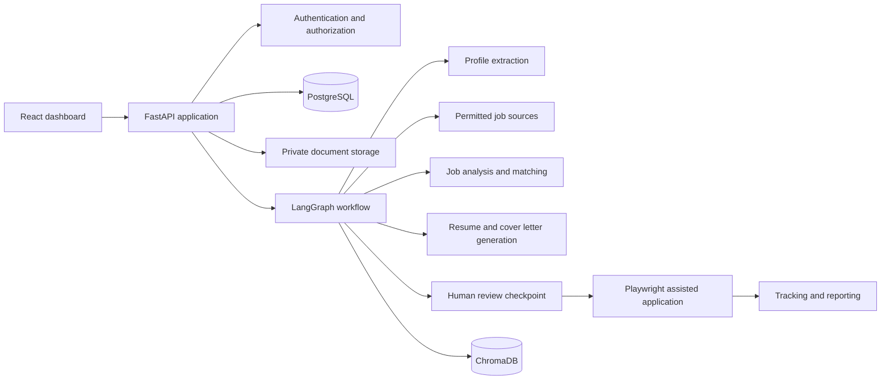

# AI-Powered Autonomous Job Application Agent

An approval-first system for discovering jobs, assessing fit, preparing truthful application materials, and tracking outcomes. External job sources are accessed only through permitted APIs, feeds, or integrations. Final applications require explicit user approval.

## System architecture



The API is the system boundary: it authenticates each request, validates input, applies user-level ownership checks, and coordinates database, file, and workflow operations. PostgreSQL is the source of truth for profile facts, jobs, matches, generated artifacts, application records, approvals, and audit history. ChromaDB is an optional retrieval index for semantic search over a user's verified profile and job text; it never replaces relational records. Uploaded originals and generated documents belong in private object/file storage, with metadata and ownership stored in PostgreSQL.

### Component architecture

- **React + TypeScript dashboard:** profile review/editing, job filters, match explanations, generated-document previews, approval queue, application status and analytics. The browser never receives model or database secrets.
- **FastAPI application:** versioned REST endpoints, Pydantic request/response schemas, authentication dependencies, service-layer orchestration, upload validation, and consistent error responses.
- **Domain/service layer:** independent profile, job discovery, analysis, document generation, application, and tracking services. Adapters isolate external providers and browser automation from business rules.
- **AI/workflow layer:** LangGraph controls durable, resumable stages and human approval. Nodes call narrow typed services; prompts and model outputs are validated against schemas. Treat model output as untrusted input and ground all resume claims in verified profile facts.
- **Persistence layer:** SQLAlchemy 2.x models and Alembic migrations for PostgreSQL; ChromaDB stores derived embeddings with user/job identifiers and a rebuild path.
- **Worker/runtime layer:** long-running discovery, document generation, status checks, and report jobs run outside web request workers. Start with a separate worker process; add a queue only when scheduling/concurrency needs it.
- **Integrations:** official APIs/feeds first. Playwright runs only against supported permitted workflows. It pauses for login, CAPTCHA, OTP, unclear form answers, and final submit approval; it must not evade access controls.
- **Operations:** structured redacted logs, health/readiness checks, audit events, secrets via environment/secret manager, Docker for local dependencies, and explicit retention/deletion policies for personal data.

### Six agents and communication

Agents are workflow stages with typed input/output contracts, not autonomous peers with unrestricted tool access. A shared LangGraph state carries identifiers and validated results (not raw secrets): `user_id`, `profile_version`, `job_ids`, analysis results, artifact IDs, approval state, application result, and a trace/correlation ID.

1. **Profile Agent** extracts candidate facts from PDF/DOCX, presents uncertain fields for confirmation, and writes only reviewed facts to the master profile. Every fact should retain provenance (source document/section and verification state).
2. **Job Search Agent** queries configured permitted sources through adapters, normalizes/deduplicates listings, and persists source URL, retrieval time, and source attribution.
3. **Job Analysis Agent** extracts required/preferred criteria and scores explicit evidence from the profile. It returns matches, gaps, evidence, and an explanation; unknown is not treated as a match.
4. **Resume Builder Agent** selects and reorders verified profile facts, then renders DOCX/PDF templates. It cannot add unsupported facts or alter identity/contact details.
5. **Application Agent** prepares and validates form values and attachments, then pauses at a durable approval checkpoint. After approval it assists with the permitted portal workflow, stops on security challenges, and records the portal result.
6. **Tracking Agent** records status changes with timestamps/source, computes dashboard metrics, and produces daily/weekly summaries.

Flow: profile ready → search → normalize/deduplicate → analyze → route unsuitable jobs to tracking/skip and suitable jobs to artifact preparation → human review of job and documents → explicit submit approval → assisted application → tracking. Failures retry only idempotent steps with bounded backoff; each external action has an idempotency key where supported. Persist graph checkpoints and audit approval identity/time so a restart cannot silently submit an application.

### Database architecture

All tenant-owned rows carry `user_id` directly or through a parent relationship. Use UUID primary keys, UTC timestamps, foreign keys, uniqueness constraints, and indexed ownership/status/date columns. Store resume documents outside the relational database and retain only private storage keys and checksums.

| Tables | Purpose and relationships |
|---|---|
| `users`, `user_profiles` | Login identity and one-to-one candidate profile/preferences; separate auth credentials from profile data. |
| `user_skills`, `education`, `work_experience`, `projects`, `certifications` | One-to-many verified profile facts; include provenance/verification fields. |
| `jobs`, `job_requirements` | Normalized listings and extracted required/preferred criteria; jobs retain source and dedupe key. |
| `job_matches` | Unique user/job analysis, score, explanation, evidence and profile version. |
| `generated_resumes`, `cover_letters` | Artifact metadata, job/profile version, private file key, model/template version and review state. |
| `applications`, `application_status_history` | One application per user/job (where applicable), approval/submission metadata and append-only status transitions. |

For production, add workflow checkpoints, audit events, refresh-token/session records, and source connectors as needed. Use Alembic for schema evolution, not runtime `create_all`.

### Project layout

```text
backend/
  pyproject.toml
  src/job_agent/
    api/              # routes and dependencies
    core/             # settings, logging, security
    db/               # engine, base, session
    domain/            # domain types and rules
    models/            # SQLAlchemy tables
    schemas/           # Pydantic API contracts
    services/          # use cases
    agents/            # agent nodes and prompts
    workflows/         # LangGraph state and graph
    integrations/      # job sources, LLM, browser, document parsing
    workers/           # scheduled/background tasks
  alembic/             # database migrations
  tests/
frontend/
  src/{app,components,features,lib}
infra/
  docker-compose.yml
```

The current Phase 1 scaffold is intentionally smaller and will grow with each phase.

### Roadmap

1. **Architecture and environment (now):** repository scaffold, configuration, local PostgreSQL, health endpoint, setup instructions.
2. **Resume parser/Profile Agent:** secure PDF/DOCX intake, extraction with provenance, confirmation UI, persisted profile.
3. **Job Search Agent:** provider interfaces and one permitted source, deduplication and job persistence.
4. **Analysis and matching:** typed requirement extraction, transparent evidence-based score and gap explanation.
5. **Resume Builder:** verified-fact selection, ATS-conscious DOCX/PDF templates and artifact review.
6. **Cover letters:** grounded, editable, job-specific drafts.
7. **Application assistance:** supported forms, validation, approval checkpoint, no security-control bypass.
8. **Tracking:** status history, metrics, reports and scheduled checks.
9. **Dashboard:** profile, discovery, review queue, application history and analytics.
10. **Integration/deployment:** migrations, end-to-end workflows, hardening, observability, backups and deployment.

We will complete one phase at a time and wait for your confirmation before starting the next.

### Technology compatibility recommendation

Use **Python 3.12** as the conservative shared runtime for the backend and pinned dependency set. Use **FastAPI with Pydantic v2**, SQLAlchemy 2.x, Alembic, PostgreSQL 16, and asyncpg or psycopg 3 (choose one driver). Pin direct dependencies in `pyproject.toml` and commit a generated lock file so transitive versions are reproducible. The starter constraints currently use compatible major-version ranges; resolve and lock them in your environment before deployment. Use `uv` for Python environments and lockfiles.

Use **Node.js 22 LTS**, React 19, TypeScript, Vite and Tailwind CSS 4 for the frontend. Keep the frontend as a separate app. Use LangGraph for workflow state, checkpoints and approval pauses; use LangChain only for integrations that save code, and call the OpenAI API through a small adapter so provider/model changes do not leak into business logic. Use ChromaDB for derived semantic retrieval and PyMuPDF/python-docx for document parsing/rendering. Keep Playwright workflows behind a human-reviewed application service.

Before adopting exact patch releases, verify the selected versions together in the lockfile and CI. Avoid `latest` tags for production images and libraries.

## Phase 1: local environment

Requirements: Git, Docker Desktop with Compose, Python 3.12, and `uv`. Docker Compose provides PostgreSQL locally; no OpenAI key is needed for this phase.

From the repository root:

```powershell
docker compose -f infra/docker-compose.yml up -d db
cd backend
uv sync
Copy-Item .env.example .env
uv run uvicorn job_agent.main:app --reload
```

Open `http://127.0.0.1:8000/docs` for the API docs and `http://127.0.0.1:8000/health` for the liveness endpoint. The health route does not yet promise database readiness; that will be added alongside database-backed features. Stop the local database with `docker compose -f infra/docker-compose.yml down` from the repository root.

### Important files

- `backend/pyproject.toml`: package metadata and backend dependency constraints.
- `backend/src/job_agent/core/config.py`: validated environment-backed settings.
- `backend/src/job_agent/main.py`: FastAPI application factory and health route.
- `infra/docker-compose.yml`: local PostgreSQL service and persistent development volume.
- `.env.example`: safe configuration template; never commit `.env`.

Phase 1 establishes the runnable API shell and local database. It does not yet parse resumes or create database tables; those belong to Phase 2.
